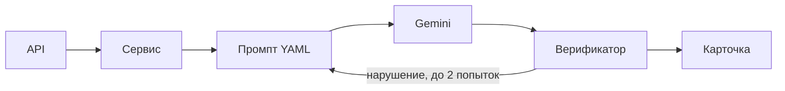

<p align="center">
  
</p>

<p align="center">
  
  
  
  
</p>

<p align="center">
  Черновик B2B-карточки контрольно-измерительного прибора из JSON: SEO-заголовок, описание, характеристики, запросы и блок для менеджера.<br>
  <a href="#быстрый-старт">Быстрый старт</a> · <a href="#как-это-работает">Как это работает</a> · <a href="#пример">Пример</a> · <a href="#безопасность">Безопасность</a> · <a href="#ограничения-и-планы">Ограничения</a>
</p>

## Что умеет
- Принимает JSON (веб-форма или `POST /api/cards`) и возвращает карточку в виде карточки, Markdown или JSON.
- Заголовок до 70 символов, описание 800–1200, 3–5 поисковых запросов, commercial-блок.
- Характеристики берёт только из входных данных; отсутствующие помечает «данных нет».
- Сообщает, каких полей не хватает (`missing_fields`), и показывает предупреждения менеджеру.
- Защищён от prompt injection, выдуманных чисел, ссылок и XSS в ответе.

## Быстрый старт
Нужны Python 3.12 и [uv](https://docs.astral.sh/uv/). Бесплатный ключ Gemini создаётся в Google AI Studio.

```bash
git clone <repo-url> && cd SpecCraft-AI
uv sync
cp .env.example .env        # впишите GEMINI_API_KEY и GEMINI_MODEL
uv run uvicorn app.main:create_app --factory
# откройте http://127.0.0.1:8000
```

Тесты и evals (ключ не нужен): `uv run pytest` и `uv run python -m evals.run_evals`.
Реальные примеры карточек: `uv run python -m scripts.generate_examples` (нужен ключ) → `examples/`.
Стили интерфейса: исходники в `frontend/`, готовый `app/static/tailwind.css` закоммичен (Node для запуска не нужен);
пересборка: `npx tailwindcss@3.4.17 -c frontend/tailwind.config.js -i frontend/input.css -o app/static/tailwind.css --minify`.

## Как это работает

Слои: `api/` только HTTP, `services/` оркестрация, `llm/` и `prompts/` адаптеры. Подробности и
сами промпты: [docs/DECISIONS.md](docs/DECISIONS.md).

## Пример
```bash
curl -s localhost:8000/api/cards -H 'Content-Type: application/json' -d @examples/inputs/manometer.json
```
Ответ: `seo_title`, `seo_description`, `characteristics[{name,value}]`, `search_queries`,
`commercial{audience,tasks}`, `missing_fields`, `warnings`, `meta`, `markdown`, `text`.
Входы лежат в [examples/inputs](examples/inputs); сгенерированные карточки появятся в `examples/`
после запуска `scripts.generate_examples`.

## Безопасность
| Угроза | Защита |
| --- | --- |
| Prompt injection | изоляция тегами + экранирование `<>`, директива в system, детектор, недоверенное описание при инъекции |
| Выдуманные факты | характеристики собирает код, верификатор проверяет каждое число, «данных нет» |
| XSS и рекламные ссылки | очистка вывода от URL, e-mail, телефонов, HTML; фронтенд пишет только через `textContent`, CSP |
| Утечка ключа и данных | ключ только из env (`SecretStr`), `.gitignore`, gitleaks, логи без тел и ключей |
| Злоупотребление API | лимит запросов, лимит тела 64 КБ, безопасные сообщения об ошибках без трейсбеков |

## Запуск не для демо
Один процесс (`--workers 1`): лимит запросов (10 в минуту на IP) и ограничитель одновременных
генераций (8, лишним ответ 503 с `Retry-After`) хранятся в памяти процесса. За reverse-proxy
запускайте с `--proxy-headers --forwarded-allow-ips=<IP прокси>`, иначе все пользователи
считаются одним клиентом, а `*` позволит подделать `X-Forwarded-For`. Прокси должен буферизовать
тело запроса (нужен `Content-Length`). `/docs` включается только при `APP_ENV=dev`.

## Ограничения и планы
- Проверяются числа; нечисловой выдуманный факт ловят только промпт и ревью менеджера.
- Лимит запросов в памяти процесса и по IP; для production нужны Redis и доверенный proxy.
- Бесплатный тариф Gemini: низкие лимиты, данные могут использоваться провайдером.
- План: адаптер локальной модели (один класс), больше evals, ожидаемые характеристики по типам приборов.

Дальше: [docs/DECISIONS.md](docs/DECISIONS.md) · [AI_LOG.md](AI_LOG.md) · [examples/](examples/)
